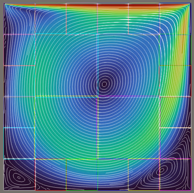
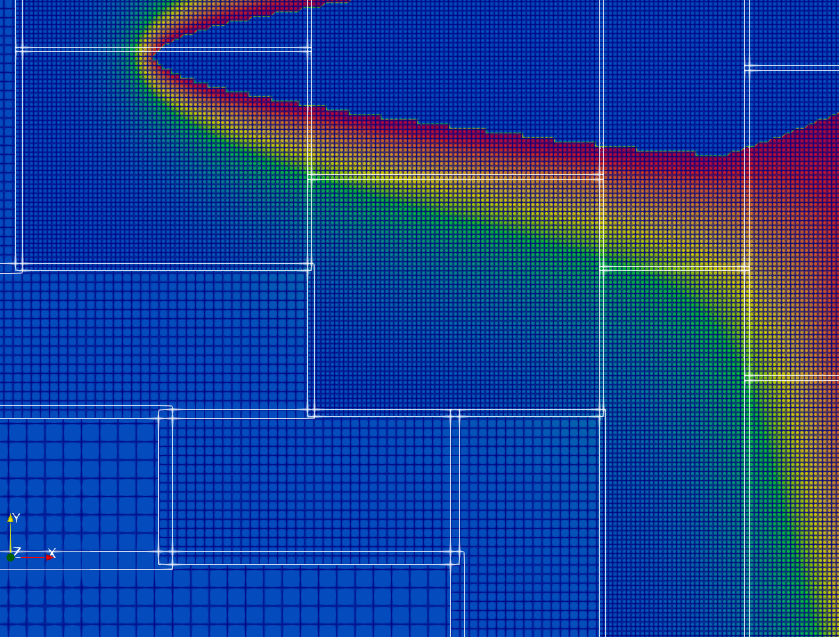

# FreeLB: Freely Coupled Lattice Boltzmann Code

This code(FreeLB) aims to facilitate the free dissemination and advancement of knowledge regarding the lattice Boltzmann (LB) coupled with other methods/models(cellular automata (CA), free surface, non-newtonian fluid...).

FreeLB should be helpful for beginners who know the basic of LBM but have not started to implement it yet, especially, for those who want to build their own LBM program.

The following pictures show the developing feature of adaptive mesh refinement(AMR) and the capability of FreeLB to couple with CA method to simulate the solidification process of a dendrite with block structure.





The author is inspired by OpenLB project, but provides a more concise and clear code structure, also, a relatively direct data access pattern, which is more suitable for beginners to understand and modify the code. The following files are modified from [OpenLB](https://www.openlb.net/) project: 
  > - 'src/data_struct/octree.h' 
  > - 'src/data_struct/octree.hh' 
  > - 'src/data_struct/Vector.h' 
  > - 'src/io/base64.h' 
  > - 'src/io/stlreader.h' 
  > - 'src/io/stlreader.hh' 
  > - 'src/parallel/mpi_manager.h' 
  > - 'src/parallel/mpi_manager.hh'
  > - 'src/lbm/freeSurface.h'

The author also used files modified from [palabos](https://palabos.unige.ch/) project:
  > - 'src/offLattice/triangleSet.h' 
  > - 'src/offLattice/marchingCube.h' 
  > - 'src/offLattice/marchingCube.hh'

This code is written in C++ for clarity and efficiency. LB and CA methods are stored in classes
under `./src`; declarations are in `.h` files and implementations in `.hh` files. To run a
simulation, prepare an `.ini` file with the parameters and write a `.cpp`/`.cu` file that calls
the methods and defines the initial and boundary conditions. See `./examples` for reference. The
module map, data model and dependency direction are in `docs/ARCHITECTURE.md`.

### Umbrella headers: `freelb.h` / `freelb.hh`

`freelb.h` (declarations) and `freelb.hh` (implementations) wrap all active modules (core LBM, free surface, STL, voxel geometry with its builder and geometry-file IO, BlockLattice CA, checkpoint, writers, field checksum); a simulation `.cpp` normally needs only these two includes (see `examples/cavity3d`).
The legacy PopLattice path is not wrapped and is frozen; `examples/legacy/*` include its headers (`data_struct/lattice.h(hh)`, `lbm/buoyancy.h`, `lbm/legacy_collision.h`, `ca/zhu_stefanescu*_legacy.h(hh)`) directly.
Every header compiles on its own except the single baseline entry in `tools/check_headers.sh` (`utils/cuda_device.h` needs `nvcc`); the host and MPI sweeps each report 95 headers with only that failure, and the script exits 0. File-by-file module map: `docs/ARCHITECTURE.md` §3.


OpenMP and MPI is enabled through the code. Cuda for multi-block structure is not supported for now

If you have any suggestions, please contact the author by email: ymmanyuan@outlook.com


## Dependencies
- C++ compiler supporting C++17
- GNU Make \
Optional(If parallel computing is needed, install):
- OpenMP
- MPI
- Cuda toolkit


## Build
To build the code, make sure you installed the above dependencies.

If you cloned without submodules, fetch them first (needed for the full build;
Quick Start works without them):
```bash
git submodule update --init third_party/cse
```

### Quick Start (no optional tools)
```bash
cd ./examples/cavity2d
make
```
The executable file will be generated in the same directory with .exe extension (please note that .exe extension is used to make the executable file recognized by .gitignore, the author did NOT test the code on Windows, but WSL is OK!)

### Full Build (with xcore pool allocator + csegen)
For optimal performance, build the optional `xcore` library and `csegen` tool first from the root directory:
```bash
make              # builds xcore library + csegen tool
cd ./examples/cavity2d
make
```
- **xcore** (`src/xcore/`): pool allocator. If xcore is absent, the build system falls back to `std::allocator` (with a warning).
- **csegen** (`tools/cse/`): CSE (common subexpression elimination) code generator. With `-D_UNROLLFOR`, the generated specializations (`.ur.h` files in `generated/lbm/`) are used; without the flag, the plain loop-based schemes compile and no `.ur.h` is touched. If csegen is missing while the flag is set, the build falls back to the plain schemes with a warning. `src/ur_fallback/lbm/` is a comparison reference only and is never compiled.

You can also build xcore and csegen separately:
```bash
make lib          # build xcore library only
make tools        # build csegen tool only
```

### Available Make Targets
| Target | Description |
|--------|-------------|
| `make` | Build xcore + csegen (from root) |
| `make lib` | Build xcore library only |
| `make tools` | Build csegen tool only |
| `make libclean` | Clean xcore build artifacts |
| `make tools-clean` | Clean csegen build artifacts |
| `make test` | Build + run the `tests/` suite (CUDA targets auto-skipped if no `nvcc`) |
| `make test-cpu` | Same, CPU + MPI only (no CUDA toolchain / GPU required) |


## Test

`tests/` holds small, self-contained targets grouped by area
(`block/`, `cuda/`, `feature/`, `io/`, `regression/`).  Run them all with:

```bash
make test          # everything available (skips CUDA when nvcc is missing)
make test-cpu      # CPU + MPI only
tests/run_tests.sh --no-cuda --no-mpi   # finer control
```

`tests/run_tests.sh` builds and runs every `tests/<category>/<name>/` target and
checks its exit status, so a test that only prints is not enough -- it must
`return flbtest::summary(...)` (see `tests/test_util.h`) or otherwise exit
non-zero on failure.  `tests/regression/cavity2d` pins the solver's
distribution-function checksum against a baseline; changing the LBM scheme,
equilibrium or boundary treatment will (intentionally) fail it.


## Checkpoint / Restart

A run can write its state periodically and resume later, including after a crash. Enable it per example with three optional keys in `[Simulation_Settings]`; absent keys mean off, so older `.ini` files keep working:

```ini
Restart = 0            ; 0 = fresh run, 1 = resume from the newest checkpoint
CheckpointStep = 0     ; > 0: write a checkpoint every N steps (and at normal exit)
RestartDir = ./ckpt    ; checkpoint directory
```

A checkpoint stores every field of every lattice/flag manager and the step counter. Format v2 also stores the geometry identity (grid, origin, per-cell entity, patches and digest) and validates it on restart; boundary and task definitions are re-created by the example's own setup, so a restart assumes the same parameters and the same block set. The rank count may differ (see below). Wired up: `examples/cavity2d`, `examples/cavity3d` (CPU) and `examples/cavity2d_cu` (GPU, single block). CA and runtime-AMR examples are not wired yet.

Resuming with a different number of ranks works when the block set does not depend on the rank count: blocks are matched by global `blockid`. `AdaptiveOptimization(mpi().getSize())` re-splits the domain per process count and is refused on a rank-count change; use `GeoHelper.CreateBlocks(bx, by[, bz])` + `LoadBalancing(np)` instead.

Checkpoints are written atomically under `RestartDir`: `latest` marks the newest complete step, and old `step_<s>` directories are not deleted automatically. A resumed run reproduces an uninterrupted one step-for-step, bit-exact (`tests/feature/checkpoint`, `tests/cuda/checkpoint`, the latter also with `make FP16=1`). A checkpoint with a different geometry, block set or POP storage precision is rejected with an error, not silently mismatched.

## Complex geometry / voxel geometry

3-D cases can take their domain/solid mask from a voxel record instead of flag boxes painted per region. `flbgeo::VoxelGeometry` (`src/geometry/voxel_geometry.h`) is an immutable, domain-sized record of role (Outside/Domain/Solid), entity, material, boundary patches and a narrow surface band; it has no IO dependency. `flbgeo::VoxelGeometryBuilder` (`src/io/voxel_geometry_builder.h`) rasterises STL meshes and box/sphere primitives into it. `flbgeo::writeVoxelFlags(geo, fields, domainFlag, voidFlag)` (`src/geometry/voxel_geometry.hh`) copies the mask into a block flag field; it overwrites the whole field, so call it after any `[region]` paint.

### `.geo` recipe and `tools/geometry_build`

A `.geo` file is the tracked source: one `[geometry]` block (`grid`, `domain`, `cell_len`, optional `band_width`) followed by ordered `[source.<name>]` blocks (`shape = box|sphere|stl`, `entity`, `material`, `role`, plus shape-specific keys). Source order is part of the semantics: a later solid can overwrite an earlier domain cell. Compile the recipe into the binary mask with:

```bash
make -C tools/geometry_build
tools/geometry_build/geometry_build.exe tests/feature/casegen_geo_box3d/geo_box3d.geo -o geo_box3d.flbgeo
```

`tests/feature/casegen_geo_box3d/geo_box3d.geo` is a minimal example.

### `.flbgeo` v1

`FLBGEO` is a build product, not a tracked fixture (`*.flbgeo` is in `.gitignore`). The file stores the format magic and version, a scalar-type tag, native-endian role/entity/material arrays, boundary patches, surface-band samples, the construction recipe, and an FNV-1a digest. A mismatched magic, version, scalar tag or digest is a hard error instead of a silently different mask. Because the format is native-endian and tagged by `float`/`double`, a file is not portable across endianness or storage precision; rebuild it from the `.geo`. The round-trip is covered by `tests/io/geometry_file`.

### casegen

`tools/casegen` exposes the same path for generated cases (3-D only). `[geometry]` takes `file`, `domain_flag`, `void_flag`, and optional `band_width` and `origin`. With one or more `[geometry.source.<name>]` sections, casegen writes `<case>.geo` into the output directory, and the generated Makefile rebuilds `<file>` with `tools/geometry_build` before linking. Without source sections, `file` is a prebuilt `.flbgeo` that must already exist in the run directory. A complete spec is `tools/casegen/cases/geo_box3d.case`; its golden is `tests/feature/casegen_geo_box3d` (16³, 100 steps). Field tables are in `tools/casegen/README.md` under `[geometry]`.

### Limits

- Boundary patches and entity/material ids are persisted and readable; `src/boundary/patch_binding.h` maps a patch kind to a task flag, and `examples/cavity3d` binds its Wall patch. Generated cases still select tasks from `[tasks]` and `[region.<name>]`, and casegen does not emit `[patch.*]` yet.
- No `.vti` export and no minimum wall-thickness validation.
- casegen never parses STL/CSG itself: an STL source is recorded in the `.geo` recipe as a path. A prebuilt geometry file and a geometry source spec are supported; direct STL/CSG import is still unsupported.
- The 2-D path is unchanged (AABB flag boxes); the CUDA device mirror is not done, and only `examples/cavity3d` consumes a geometry file.

## MPI communication

Halo exchanges coalesce all links to one peer into **one message per peer rank per exchange**, so the message count follows the peers a rank talks to, not the number of blocks. The call sites do not change. Communication plans are rebuilt for every depth whenever the blocks or fields are rebuilt, and they reuse their buffers, so a step does not allocate. The level-filtered `(count)` overloads used by AMR sub-cycling coalesce the same way. The hidden-communication step uses the same coalesced plans (`CommMode` selects partial, full or all), and the cross-level `AverageCommunicate()` / `InterpolateCommunicate()` exchanges remain one message per communicator with the `MPI_Barrier()` that the sub-cycled path needs.

**Known defect: partial exchange.** `NormalCommunicate()` refreshes only the populations selected by `getCommPopDir()` for each neighbour. The interior reads those from the halo, but the halo is collided too, and no proper subset of the populations is closed under collision; `Stream()` then carries the unrefreshed slots around the ring, including parts that no exchange writes. `NormalFullCommunicate()` is the correct reference (a single-block run agrees with it). In the measured 2-D same-level runs with `Collide → Stream → Communicate`, partial is bit-identical on the block interfaces, with the residual confined to domain-boundary cells; with the repository's `Stream → Collide → Communicate` order it diverges from the interfaces inward within a few steps. 3-D has no consistency evidence, and AMR is not supported. Affected: `cazsAref2d` and `openboundary2d` (partial), `cavity2d`/`cavity3d` (hidden step built on partial); `couette2d`/`cavref2d` use full. Usable range and rejected subsets: [docs/INTP_COMM_OVERFLOW_BUG.md](docs/INTP_COMM_OVERFLOW_BUG.md) §18.9 ("partial usable-range criterion" / usable range); defect and unfixed scope: [docs/INTP_COMM_OVERFLOW_BUG.md](docs/INTP_COMM_OVERFLOW_BUG.md) §18 ("same-level partial communication" / Same-level partial communication).

Field exchanges use a separate tag range, so a decomposition must stay below 16384 blocks. An Aver/Intp cell index outside its block aborts through `flbcomm::checkCellIndex()` instead of writing past the block; a refined block clipped at the domain edge can produce one ([docs/INTP_COMM_OVERFLOW_BUG.md](docs/INTP_COMM_OVERFLOW_BUG.md)).

Coalescing is measured by `benchmarks/plain_comm` (2-D 120×120, 10×10 blocks, 2 ranks, exchange only): build with `make -C benchmarks/plain_comm`, then run `mpirun -np 2 benchmarks/plain_comm/2d/plain_comm_bench2d.exe 120 10 <steps>`. The output reports exchange time per step and the communicator/message layout; the reference run (2026-10-18) coalesced 226 communicators per step into 1 message. The 3-D 4×4×4 grid on 2 ranks reports 300 communicators per step, also coalesced into one message.

## Benchmark
The table gives the lid-driven cavity flow benchmark (`benchmarks/cavity3d` and `benchmarks/cavity3d_cu`): D3Q19, 100×100×100, FP32, in million lattice updates per second (MLUPs). CPU command: `cd benchmarks/cavity3d && make && ./cavity3d.exe`; GPU: the same under `benchmarks/cavity3d_cu`. Entries date from 2024-08 – 2025-05 and were measured on the device shown; compare only on the same machine.

| Device | Platform | FP32 MLUPs |
| :----- | :---- | :---- |
| i9-14900K       | Ubuntu 22.04      | 651 | 
| Ryzen 9 9950X (Thanks to Wu Kai) | Ubuntu 24.04 WSL2 | 645 |
| E5-2699v4       | Ubuntu 20.04 WSL2 | 553 |
| i7-11800H       | Ubuntu 22.04 WSL2 | 173 |
| i7-8750H        | Ubuntu 22.04 WSL2 | 124 |
| RTX 4080        | Ubuntu 22.04      | 2939 |
| RTX 3060 Laptop | Ubuntu 22.04 WSL2 | 1581 |


## License
FreeLB is licensed under the GNU GPL v3 license.

## Acknowledgement
The author would like to thank OpenLB project for the inspiration of this code and thank Prof. Jing Tao for his support in the development of this code.